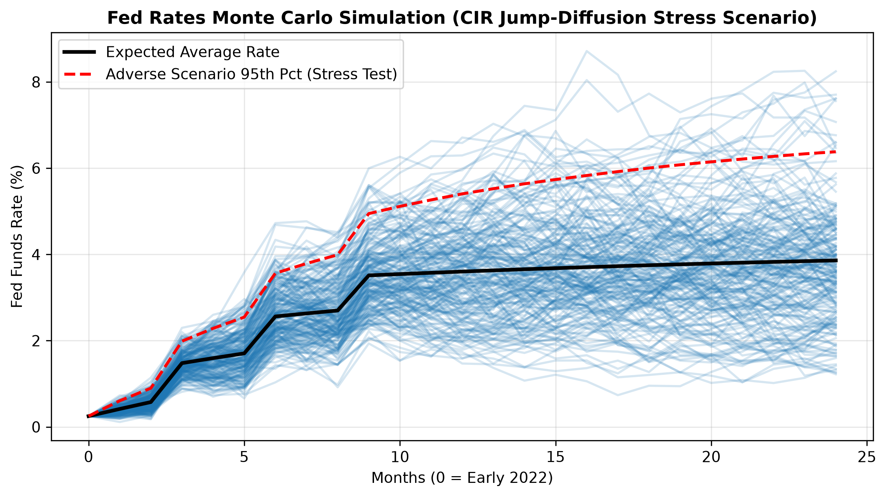
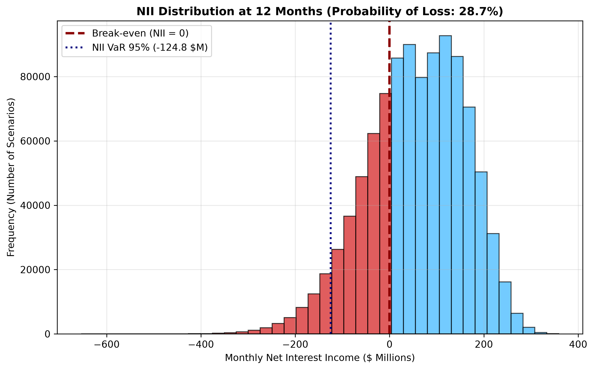
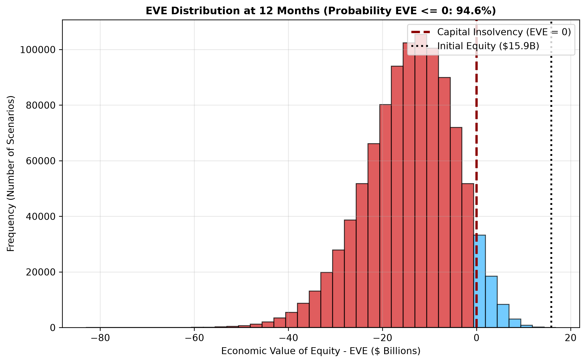
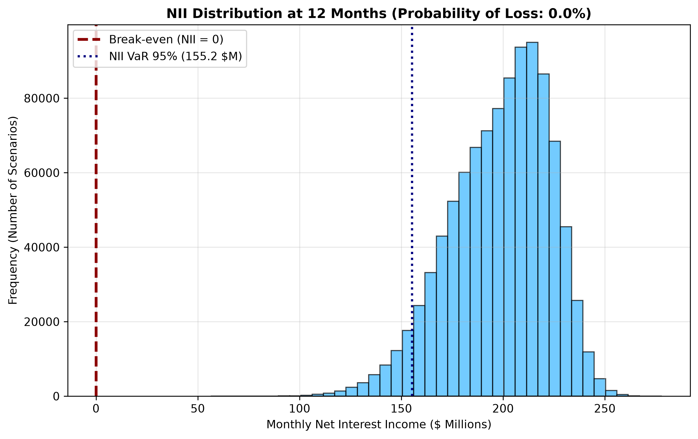
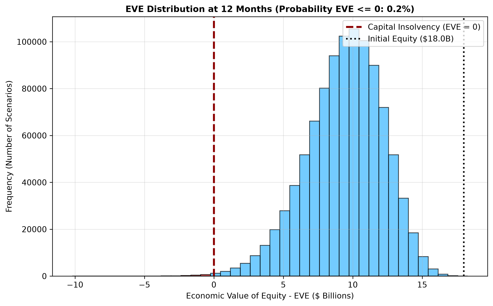

# Stochastic ALM & IRRBB Stress-Testing Engine
**Monte Carlo Balance Sheet Simulation (CIR Jump-Diffusion) — First Republic Bank Case Study**

A vectorized Asset-Liability Management (ALM) and Interest Rate Risk in the Banking Book (IRRBB) simulation engine built in Python. Starting from bank Call Report balance sheet data, the model simulates stochastic interest rate trajectories and evaluates the joint impact on short-term accounting earnings (**NII**), long-term economic capital (**EVE**), regulatory solvency (**CET1 Ratio**), and liquidity resilience (**LCR**).

---

## Methodology & Simulation Pipeline

For each Monte Carlo simulation path $i = 1, \dots, N$ (default $N = 100,000$) over a 24-month horizon ($t = 1, \dots, 24$), the engine executes four sequential stages:

1. **Balance Sheet Ingestion (`load_balance_sheet_from_csv`)**  
   Parses official FDIC Call Report line items (assets, liabilities, insured/uninsured deposits, and equity) from a CSV snapshot.
2. **Stochastic Interest Rate Engine (`simulate_cir_and_plot`)**  
   Generates the $i$-th Fed Funds rate trajectory $r_{i,t}$ using a **Cox-Ingersoll-Ross (CIR)** mean-reverting process augmented with **Jump-Diffusion** shocks calibrated to discrete FOMC tightening steps ($r_0 = 0.25\%$, $\bar{r} = 4.25\%$, $a = 0.50$, $\sigma = 8\%$):
   $$dr_{i,t} = a(\bar{r} - r_{i,t})dt + \sigma\sqrt{r_{i,t}}\,dW_{i,t} + J_{i,t}$$
3. **Dynamic Earnings, Capital & Liquidity (`simulate_alm_dynamics`)**  
   Maps each rate path $r_{i,t}$ into balance sheet cash flows using granular asset/liability pass-through betas (`ALM_PARAMS`) and an endogenous **uninsured deposit run trigger** when rates breach the $3.5\%$ threshold:
   * **Monthly Net Interest Income ($\text{NII}_{i,t}$):** Interest income on loans, securities, and cash reserves plus Pay-Fixed/Receive-Floating Interest Rate Swap (IRS) net cash flows, minus funding costs.
   * **Dynamic Solvency ($\text{CET1}_{i,t}$):** Tracks cumulative retained earnings/losses against Risk-Weighted Assets (RWA) calibrated to the Call Report.
   * **Dynamic Liquidity ($\text{LCR}_{i,t}$):** Tracks High-Quality Liquid Assets (HQLA) over 30-day stressed net cash outflows as uninsured deposits run off.
4. **Economic Value of Equity (`calculate_and_plot_eve`)**  
   Computes the cross-sectional distribution of $\text{EVE}_{i,T}$ by discounting asset and liability duration gaps ($D_A \approx 7.0\text{ yrs}$ vs. $D_L \approx 0.7\text{ yrs}$), net of the duration offset provided by the IRS hedge.

#### Stochastic Rate Scenario Generation (CIR Jump-Diffusion)



---

## Empirical Validation: First Republic Bank (FRB)

The engine is validated on First Republic Bank's balance sheet evolution (`simulazione_ottima.csv`), bridging historical regulatory reporting with management's pro-forma restructuring across sequential time snapshots:

- **Historical Baseline (`COL_IDX = 2`, `IRS_NOTIONAL = 0.0` — Q4 2021 FDIC Call Report):** Captures First Republic Bank's pre-crisis structure ($181.09B total assets, $79.21B fixed-rate 1–4 family mortgages, and $116.70B uninsured deposits). Illustrates the *IRRBB Paradox*—short-term NII remains positive in **71.3%** of scenarios at 12 months due to sticky deposit repricing, while **94.6%** of paths result in economic capital insolvency ($\text{EVE} \le 0$).
- **Interim Trajectory (`COL_IDX = 3..7`):** Sequential month-by-month evolution of balance sheet items under rising interest rates.
- **Pro-Forma Hedged Restructuring (`COL_IDX = 8`, `IRS_NOTIONAL = 70000.0`):** Target balance sheet after liquidity rebalancing and funding restructuring, hedged with a $70B Pay-Fixed IRS against rate hikes.

### Stress Test Results (12-Month Horizon — Unhedged Baseline)

| Earnings View: 12-Month NII Distribution | Economic Value View: 12-Month EVE Distribution |
| :---: | :---: |
|  |  |

#### Quantitative Stress-Test Summary (Unhedged Baseline — $N = 100,000$ Paths)

| Horizon | Mean Fed Rate (P95) | Mean NII (VaR 95%) | Prob. $\text{NII} \le 0$ | Mean EVE (VaR 95%) | $\Delta\text{EVE}$ | Insolvency Risk ($\text{EVE} \le 0$) | Mean CET1 | Mean LCR (Breach Prob.) |
| :---: | :---: | :---: | :---: | :---: | :---: | :---: | :---: | :---: |
| **t = 6m** | 2.56% (3.56%) | $171.2M ($76.8M) | 0.3% | -$4.37B (-$13.68B) | -$20.27B | 78.8% | 10.65% | 69.3% (100.0%) |
| **t = 12m** | 3.60% (5.40%) | $56.3M (-$124.8M) | 28.7% | -$14.20B (-$31.17B) | -$30.10B | 94.6% | 11.00% | 59.3% (100.0%) |
| **t = 18m** | 3.75% (6.00%) | $37.2M (-$183.0M) | 35.6% | -$15.59B (-$36.88B) | -$31.49B | 92.2% | 11.16% | 62.9% (100.0%) |
| **t = 24m** | 3.86% (6.38%) | $24.6M (-$219.5M) | 39.1% | -$16.64B (-$40.46B) | -$32.54B | 91.6% | 11.26% | 70.7% (100.0%) |

> **Key Takeaway — The IRRBB & Liquidity Paradox:** At $t = 12\text{m}$, accounting metrics still mask the underlying fragility: expected monthly NII remains positive ($56.3M, positive in **71.3%** of paths) and book CET1 stands at **11.00%**. However, on a mark-to-market basis, the severe duration mismatch erodes **-$30.10B** of economic value, pushing **94.6%** of simulated scenarios into economic insolvency ($\text{EVE} \le 0$) while the **LCR** remains structurally below the 100% regulatory minimum (**59.3%**) across 100% of paths.

### Pro-Forma Hedged Restructuring (12-Month Horizon — $70B IRS Overlay)

To neutralize the duration mismatch and prevent deposit flight, the restructuring plan combines balance sheet rebalancing (expanding cash/HQLA buffers and reducing reliance on runnable uninsured funding) with a **$70B Pay-Fixed / Receive-Floating Interest Rate Swap** overlay:

| Post-Hedge Earnings: 12-Month NII Distribution | Post-Hedge Capital: 12-Month EVE Distribution |
| :---: | :---: |
|  |  |

#### Quantitative Comparison: Unhedged Baseline vs. Pro-Forma Hedged ($t = 12\text{m}$)

| Metric ($t = 12\text{m}$ Stress Horizon) | Unhedged Baseline (`COL_IDX = 2`) | Pro-Forma Hedged (`COL_IDX = 8`, $70B IRS) | Net Risk Reduction / Impact |
| :--- | :---: | :---: | :---: |
| **Mean Monthly NII (VaR 95%)** | $56.3M (-$124.8M) | **$198.6M ($155.2M)** | **+$142.3M (+$280.0M tail)** |
| **Prob. of NII Loss ($\text{NII} \le 0$)** | 28.7% | **0.0%** | **-28.7 pp (Eliminated)** |
| **Mean EVE (VaR 95%)** | -$14.20B (-$31.17B) | **$9.42B ($4.58B)** | **+$23.62B (+$35.75B tail)** |
| **Capital Insolvency Risk ($\text{EVE} \le 0$)** | 94.6% | **0.2%** | **-94.4 pp (Neutralized)** |
| **Mean CET1 Ratio** | 11.00% | **14.68%** | **+368 bps** |
| **Mean LCR (Breach Prob. < 100%)** | 59.3% (100.0%) | **217.1% (0.0%)** | **+157.8 pp (Compliant)** |

> **ALM Desk Conclusion:** Combining balance sheet liquidity rebalancing with a $70B Pay-Fixed IRS overlay resolves the IRRBB trade-off: economic capital insolvency risk at $t = 12\text{m}$ drops from **94.6% to 0.2%**, monthly NII remains positive across **100%** of simulated rate paths, and LCR stays comfortably above the 100% regulatory threshold (**217.1%**).

---

## Project Architecture

```text
├── alm_engine.py          # Vectorized CIR engine, NII/EVE/CET1/LCR calculators & plotting
├── main.py                # Scenario configuration and execution script
├── balance_sheet.csv # FDIC Call Report historical & pro-forma snapshots
├── starting_scenario/     # Baseline (COL_IDX=2, Unhedged) plots & executive summary CSV
├── hedged_scenario/       # Pro-forma (COL_IDX=8, $70B IRS) plots & executive summary CSV
└── requirements.txt       # Python dependencies
